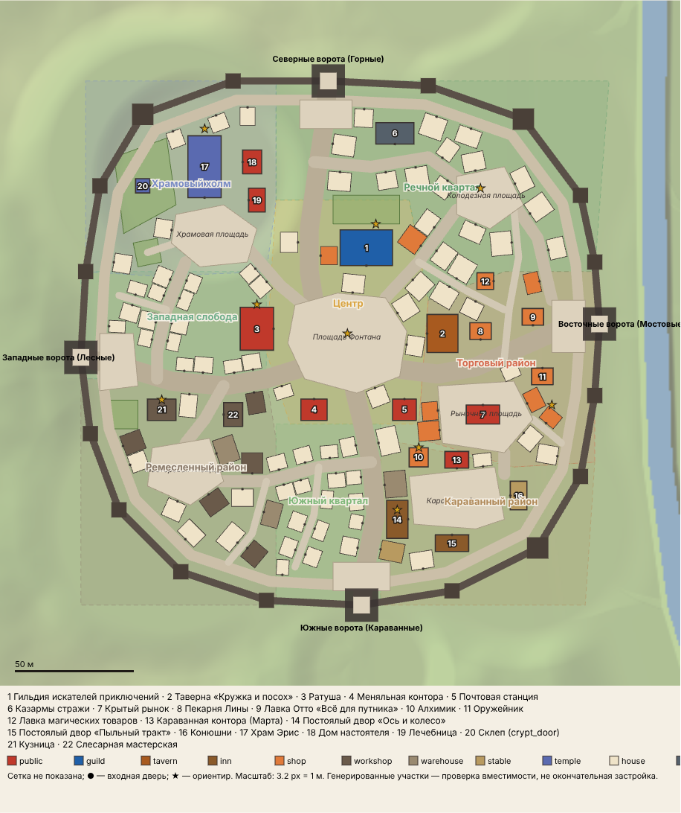
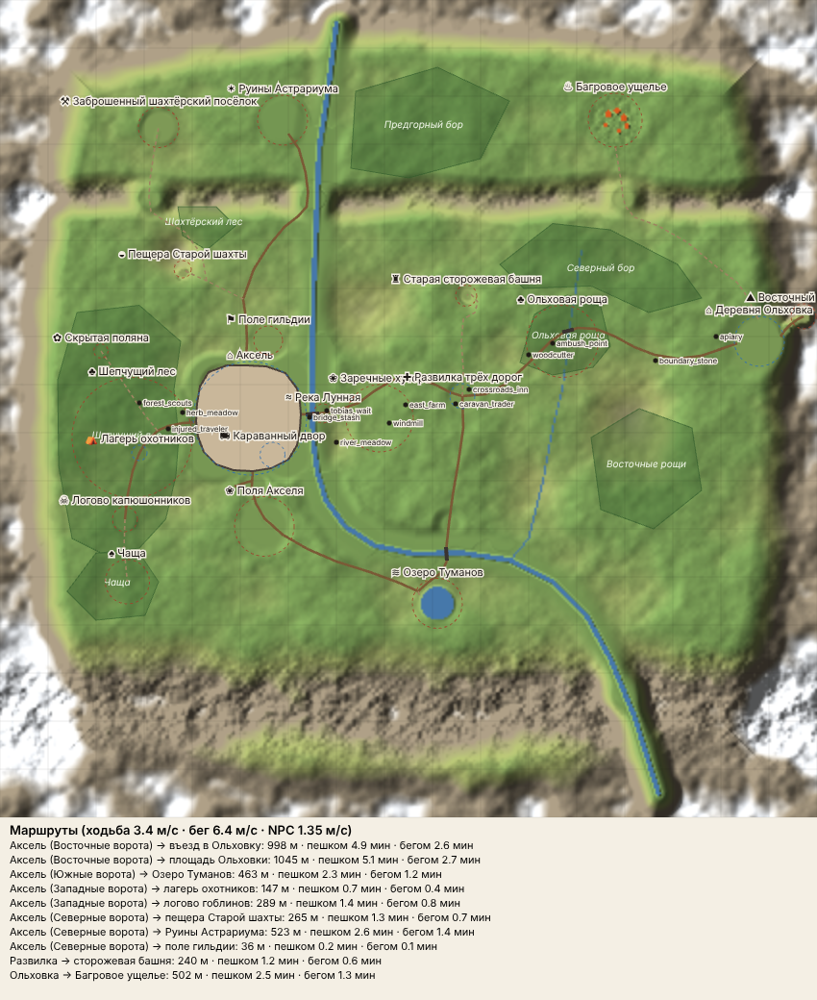

# План нового Акселя и окрестностей (этап 2)

Дата: 2026-10-10. Основа — аудит `docs/axel-rebuild-audit.md` и решения пользователя:
1. Стена неправильной формы.
2. Четверо ворот; дороги и деревни перерабатываются вместе с городом.
3. Стены, башни и ворота — из Kenney castle-kit.
4. Ключевые здания — на новых местах, проработанные детально.

**Работающий мир не тронут.** План задан данными, а проверяет и рисует его отдельный скрипт:

| Файл | Что внутри |
|---|---|
| `tools/plan/world_plan.mjs` | новая карта в формате `MapData.js`: регионы, река, дороги, мосты, площадки, холмы, хребты, леса, точки по пути |
| `tools/plan/axel_plan.mjs` | город в локальных координатах: стена, ворота, улицы, площади, районы, ключевые здания, ориентиры |
| `tools/plan/render_plan.mjs` | проверка и отрисовка: `node tools/plan/render_plan.mjs` |
| `docs/plan/axel.svg` / `.png` | схема города: районы, улицы, стена, здания с дверями, ориентиры |
| `docs/plan/region.svg` / `.png` | схема долины: рельеф, река, дороги, мосты, регионы, леса, маршруты с временем |
| `docs/plan/report.json` | все цифры этого документа |

Скрипт запускает **настоящую модель рельефа** `src/world/Terrain.js` на данных плана (импорт подменяется
в копии модуля, исходник не меняется) и проверяет:
- дороги пересекают воду только на мостах, уклон дорог не больше 30 %;
- центры регионов не в горах и не в реке; стена не ближе 6 м к воде;
- улицы не выходят за стену;
- здания не залезают на улицы, площади, кладбище и дворы, не задевают стену и пристенную улицу,
  не пересекаются между собой и стоят на ровной земле (перепад не больше 0,6–0,8 м).

**Текущий результат: замечаний нет.**



---

## 1. Масштаб и координаты

- Единицы прежние: 1 единица = 1 м, север = −Z, восток = +X. Скорости из кода: ходьба 3,4 м/с, бег 6,4 м/с,
  NPC 1,35 м/с (`CharacterController.js`, `NPCManager.js`).
- **Карта растёт: `HALF` 450 → 850** (квадрат 1,7 × 1,7 км). Иначе 5 минут пути между поселениями
  (≥ 1 км дороги) не помещаются без пустых полей: в квадрате ±450 даже диагональ всего 1,27 км.
  Лишняя площадь занята рельефом, а не пустыми полями:
  - хребет на севере (z ≈ −440) с тремя проходами;
  - южный горный массив (z ≈ +500…+800), река уходит через ущелье;
  - краевые горы.
- Полоса краевых гор в `Terrain.js` сейчас записана числами (`smoothstep(330, 430, e)`). В плане она
  считается от `HALF`: `smoothstep(HALF − 120, HALF − 20, e)`. При `HALF = 450` это то же самое.
- **Аксель** — центр площади Фонтана в мировой точке **(−330, 20)**, уровень земли 1,0. Город задаётся
  в локальных координатах (u = восток, v = юг, метры от центра площади): мир = (−330 + u, 20 + v).
  Так город можно сдвинуть одной константой.
- **Подземелье** сейчас лежит в z 690…810 и с новой картой попало бы на рельеф. Его нужно сдвинуть на
  +400 по z (z 1090…1210; регион `dungeon` в (0, 1160)). Двери ссылаются на spots, а не на координаты,
  поэтому кроме `Dungeon.js` ничего менять не нужно.

---

## 2. Долина: география и маршруты



```
 z −850 ─────────────────────── краевые горы ───────────────────────
        Заброшенный посёлок        Руины Астрариума            Багровое ущелье
          (−520,−585)                (−262,−600)                  (430,−600)
 z −440 ══╡проход╞══════════════╡проход + река╞═════════════════╡проход╞═══ хребет
        Шахтёрский лес   Пещера шахты            Северный бор
                          (−470,−290)       Сторожевая башня (120,−235)
                   Поле гильдии (−292,−142)            │ тропа
   Шепчущий лес    ┌────────────┐ река  Заречные хутора │           Ольховая роща
   (охотники,      │   АКСЕЛЬ   │══мост══ мельница ──── ✚ Развилка ──── ручей ──── межевой ── ОЛЬХОВКА
    поляна,        │ (−330, 20) │  Лунная   (−40,30)     (112,−26)    (330,−160)  камень    (730,−140)
    гоблины)       └────────────┘   │                      │                                  └ Восточный
   Чаща          Поля Акселя         \                     │ мостовая дорога                    перевал (822,−192)
   (−585,360)    (хутор Бориса)       \____ река ____ Южный мост (79,300)
                                            Озеро Туманов (60,405)
 z +500 ─────────────────── южный горный массив (река уходит ущельем на юго-восток) ───────────────
```

### Ключевые решения
- **Река Лунная** течёт с северных гор через проход в хребте, вдоль восточной стены Акселя (19 м от
  стены до воды), затем поворачивает на юго-восток и уходит ущельем в южном массиве. Восточные ворота
  выходят прямо на **Лунный мост** (тайник `bridge_stash` под мостом сохраняется).
- **Ольховка** переезжает на восток, в предгорную бухту у края гор: «последний привал перед перевалом».
  Дорога туда проходит через Заречные хутора, Развилку и Ольховую рощу.
- **Шепчущий лес** растёт к западу от города, между ним и стеной остаётся луг шириной ≈ 30 м
  (травы `herb_meadow`).
- **Поля Акселя** (хутор Бориса, поля, амбар, место ночного набега) лежат к югу от Южных ворот.
- **Мельница** стоит на Мельничном холме у восточной дороги; её видно со стен.

### Дороги (id прежние, где роль та же)
| Дорога | Откуда → куда | Длина, м | Макс. уклон |
|---|---|---|---|
| `east_road` | Восточные ворота → Лунный мост → хутора → Развилка → Ольховая роща → Ольховка | 998 | 29 % (на 10 м) |
| `south_road` | Южные ворота → караванная стоянка → хутор Бориса → вдоль реки → Озеро Туманов | 463 | 20 % |
| `bridge_road` (новая) | Развилка → Южный мост → к южной дороге (кольцо вокруг излучины) | 435 | 25 % |
| `west_road` | Западные ворота → луга → развилка леса → лагерь охотников → логово гоблинов | 289 | 27 % |
| `north_road` | Северные ворота → поле гильдии → развилка → вдоль реки через проход → Астрариум | 523 | 20 % |
| `cave_road` | развилка на северной дороге → пещера Старой шахты | 140 | 27 % |
| `mines_road` | от пещерной тропы, вокруг Шахтного холма → западный проход → заброшенный посёлок | 373 | 22 % |
| `tower_trail` | Развилка → серпантин на холм → сторожевая башня | 240 | 28 % |
| `lava_road` | Ольховка → восточный проход → Багровое ущелье | 502 | 31 % |
| `east_pass_road` | Ольховка → Восточный перевал (подъём цепочкой площадок) | 65 | 32 % |
| `glade_trail`, `thicket_trail`, `lake_trail`, `caravan_lane` | лесные тропы, к озеру, к стоянке | 204 / 130 / 13 / 39 | ≤ 13 % |

Уклон считается на отрезке 10 м по реальному рельефу. Короткие участки 29–32 % — это подъём на
перевал и в ущелье, на равнине уклоны не больше 25 %. Мосты: Лунный (каменный, 7 м), Южный (каменный,
5,5 м), Ольховый мостик через ручей (дощатый, 4 м).

### Время в пути (по дорогам)
| Маршрут | Метры | Пешком | Бегом | NPC 1,35 м/с |
|---|---|---|---|---|
| **Аксель (Восточные ворота) → въезд в Ольховку** | **998** | **4,9 мин** | 2,6 мин | 12,3 мин |
| **Аксель (Восточные ворота) → площадь Ольховки** | **1045** | **5,1 мин** | 2,7 мин | 12,9 мин |
| Аксель (Северные ворота) → Руины Астрариума | 523 | 2,6 | 1,4 | 6,5 |
| Ольховка → Багровое ущелье | 502 | 2,5 | 1,3 | 6,2 |
| Аксель (Южные ворота) → Озеро Туманов | 463 | 2,3 | 1,2 | 5,7 |
| Аксель (Западные ворота) → логово гоблинов | 289 | 1,4 | 0,8 | 3,6 |
| Аксель (Северные ворота) → пещера Старой шахты | 265 | 1,3 | 0,7 | 3,3 |
| Развилка → сторожевая башня | 240 | 1,2 | 0,6 | 3,0 |
| Аксель (Западные ворота) → лагерь охотников | 147 | 0,7 | 0,4 | 1,8 |
| Аксель (Северные ворота) → поле гильдии | 36 | 0,2 | 0,1 | 0,4 |

**Сопровождение Тобиаса.** NPC сейчас ходит 1,35 м/с, и путь занял бы 13 минут. Предлагается дать
сопровождению свою скорость ≈ 2,8 м/с (у Тобиаса мул с тележкой): путь займёт ≈ 6 минут, игрок идёт
шагом рядом. Маршрут эскорта берётся из точек `east_road`, а не из чисел в `dialogues.js:270`.

### Что встречается по пути в Ольховку (≈ 1 км)
| Метры от ворот | Место | Назначение |
|---|---|---|
| 0–40 | Лунный мост, тайник под ним, `tobias_wait` у моста | сундук `bridge_stash`; отсюда стартует эскорт |
| 40–150 | речной луг (`river_meadow`) к югу от дороги | грибы — заказ «грибы на лугу» |
| 150–330 | Заречные хутора: мельница на холме, заречный хутор, поля | ориентир, видно со стены |
| ≈ 345 | **Развилка трёх дорог**: корчма «Подкова», колодец, часовенка Эрис, указатель; север — башня, юг — Южный мост | безопасная зона, стоянка купца Сайруса (`caravan_trader`, чётные дни) |
| 450–650 | **Ольховая роща**: хижина дровосека, Ольховый мостик через ручей, засада (`ambush_point`) | засада грибов при эскорте |
| ≈ 780 | старый межевой камень, развилка тропы к ущелью | ориентир, место случайного события |
| 900–1000 | пасека и сады Ольховки | въезд в деревню |

### Регионы (id сохранены; новые отмечены)
| id | Центр (x, z) | r | Примечание |
|---|---|---|---|
| `axel` | −330, 20 | 118 | безопасная зона; контрольная точка на площади Фонтана |
| `caravan` | −283, 96 | 26 | теперь внутри стен: Караванный двор |
| **`guild_field`** (новый) | −292, −142 | 30 | поле гильдии **не** безопасная зона: Explosion в прологе работает |
| `farms` | −300, 245 | 62 | хутор Бориса |
| `river` | −178, 10 | 20 | Лунный мост |
| **`east_fields`** (новый) | −60, 20 | 70 | Заречные хутора, мельница |
| **`crossroads`** (новый) | 112, −26 | 26 | Развилка, безопасная зона |
| **`alder_wood`** (новый) | 320, −140 | 75 | Ольховая роща |
| `olkhovka` | 730, −140 | 52 | безопасная зона |
| `forest` / `hunters` / `glade` / `goblin_den` / `thicket` | −575, 60 / −560, 92 / −640, −120 / −590, 230 / −585, 360 | 125 / 16 / 15 / 26 / 46 | запад и юго-запад |
| `watchtower` / `cave` | 120, −235 / −470, −290 | 22 / 18 | |
| `astrarium` / `crimson_gorge` / `old_mines` | −262, −600 / 430, −600 / −520, −585 | 52 / 56 / 42 | за хребтом |
| `mist_lake` / `east_pass` | 60, 405 / 822, −192 | 52 / 26 | |
| `dungeon` | 0, 1160 | 70 | интерьер, сдвинут на +400 по z |

Леса заданы многоугольниками (`FORESTS`): Шепчущий лес 11 га, Предгорный бор 5,5, Северный бор 4,3,
Восточные рощи 4,2, Ольховая роща 2,2, Чаща 1,9, Шахтёрский лес 0,7. Растительность (`_buildVegetation`)
должна брать их вместо нынешних двух кругов. Плотность придётся снизить относительно нынешних
~230 деревьев/га, иначе деревьев станет в 5 раз больше: бюджет ≈ 2000 экземпляров на карту.

---

## 3. Город

### Размеры
| Параметр | Значение |
|---|---|
| Внешний контур | ≈ 218 × 220 м, неправильный 20-угольник |
| Площадь внутри стены | 40 800 м² (было ≈ 10 000 м²) |
| Периметр стены | 727 м ≈ 182 секции castle-kit по 4 м |
| Башни | 16, из них 3 большие: Речная (СВ), Караванная (ЮВ), Храмовая (СЗ) |
| Ворота | 4 |
| Улицы | главные 365 м (8 м), второстепенные 354 м (5 м), переулки 235 м (3 м), пристенная 676 м (4,5 м) |
| Ворота → площадь Фонтана | север 93 м, восток 88 м, юг 91 м, запад 93 м (≈ 27 с шагом, 14 с бегом) |
| Через весь город | ≈ 185 м: 55 с шагом, 29 с бегом |
| Зданий в проверочной застройке | **116**: 22 ключевых + 94 сгенерированных |
| Пятно застройки | 8 200 м² (20 % площади) |

### Стена, башни, ворота (castle-kit)
- **Секция стены:** `castle/wall` (1 × 1,31 × 1 ед.), масштаб ≈ [4, 5,7, 3] → секция 4 м, высота ≈ 7,5 м,
  толщина 3 м, ≈ 180 треугольников на секцию. Для коллизии — коробки (`collide: 'box'`), это дёшево.
- **Башни** — наборы `tower-square-base` + `-mid*` + `-top-roof*` (большие — `tower-hexagon-*`), шаг 5–6 м.
- **Ворота** — две башни `tower-square-mid-door` и арка `wall-doorway`/`tower-square-arch` с поднятой
  решёткой `metal-gate`. Проход 7 м.
- Палитра castle-kit перекрашивается в `KitLibrary` (тёплый серый камень). Перед всей стеной ставим
  пробную секцию с воротами и показываем пользователю: в аудите отмечено, что «как есть» набор
  выглядит игрушечно.
- Стену сделать группой `axel_wall` (одна группа на всю стену), а ворота и большие башни — отдельными
  группами, чтобы их можно было подвинуть редактором.

| Ворота | Локально (u, v) | Мир (x, z) | Куда ведут | Пост стражи (spot) |
|---|---|---|---|---|
| Северные (Горные) | −8, −110 | −338, −90 | поле гильдии, шахта, Астрариум | `gate_north` (Хайнц) |
| Восточные (Мостовые) | 106, −8 | −224, 12 | Лунный мост → Ольховка | `gate_east` |
| Южные (Караванные) | 6, 110 | −324, 130 | караванная стоянка, поля, озеро | `gate_south` (Бернард) |
| Западные (Лесные) | −112, 6 | −442, 26 | луга, Шепчущий лес | `gate_west` |

### Улицы
- **Главные (8 м: телеги в обе стороны, пешеходы, фонари каждые ~16 м).** Четыре улицы идут от ворот
  к площади Фонтана с изгибами и входят в неё не по осям, поэтому крестовины нет:
  - Горная — с севера;
  - Мостовая — с востока, мимо Рыночной площади;
  - Караванная — с юга;
  - Кузнечная — с запада, мимо Мастеровой площади.
- **Второстепенные (5 м):**
  - Храмовый подъём — пандус 37 м на +1,9 м, уклон 5 %;
  - Колодезная, Набережная, Гильдейская, Рядская;
  - Слесарный проезд, Южная поперечная, Слободская.
- **Переулки (3 м)** — альтернативные маршруты, арки и проходы во дворы: Кривой, Кошачий, Арочный
  проход, Садовый проход, Задний ряд, Тесный, Пивной.
- **Пристенная улица (4,5 м)** идёт по кругу в 8 м от стены. Это патрули стражи, подход к башням и
  обходной маршрут NPC; на неё выходят задние дворы.
- **Правило:** дома, заборы и декор не заходят на улицы. Скрипт держит зазор ≥ 0,4 м от края
  проезжей части и 0,8 м от фасада.

### Площади и открытые места
| Площадь | Площадь, м² | Что там |
|---|---|---|
| Площадь Фонтана | 1 640 | фонтан со статуей Эрис, скамейки, городская доска; на неё выходят гильдия, таверна, ратуша, меняла, почта |
| Рыночная площадь | 940 | крытый рынок посередине, 8–12 прилавков по краям |
| Караванный двор | 850 | разгрузка, повозки, коновязь; постоялые дворы, конюшни, контора |
| Храмовая площадь | 690 | на террасе (+2,4 м); перед храмом, лечебница, дом настоятеля |
| Мастеровая площадь | 630 | колодец, рабочие дворы, кузница рядом |
| Колодезная площадь | 510 | старая липа и колодец (spot `well`) |
| Площадки у ворот | 260–350 | стража, разворот телег |
| Кладбище, Тайный сад, Лесной склад, Двор гильдии | — | открытые участки без построек |

### Районы
Границы мягкие: районы переходят друг в друга через площади и улицы.

| Район | Где | Характер | Ориентир | Зданий |
|---|---|---|---|---|
| **Центр** | вокруг площади Фонтана | гильдия, таверна, ратуша, меняла, почта, дома с лавками | фонтан, колокольня гильдии (синяя крыша), часы ратуши | 8 |
| **Торговый район** | восток, от площади до Восточных ворот | Рыночная площадь, крытый рынок, пекарня, лавка Отто, оружейник, лавка магических товаров, ряды | крытый рынок с часами | 12 |
| **Караванный район** | юго-восток, Южные ворота | Караванный двор, «Ось и колесо», «Пыльный тракт», конюшни, склады, контора Марты | колесо-вывеска «Оси и колеса», Караванная башня | 8 |
| **Ремесленный район** | юго-запад, Западные ворота | кузница, слесарная, мастерские, склады, лесной склад у ворот | труба кузницы с дымом | 16 |
| **Храмовый холм** | северо-запад, терраса +2,4 м | храм Эрис, кладбище со склепом (`crypt_door`), лечебница, дом настоятеля, Тайный сад | шпиль храма (самое высокое здание) | 7 |
| **Речной квартал** | северо-восток, вдоль реки | зажиточные 2–3-этажные дома, дворы, сады, казармы у Северных ворот | старая липа на Колодезной площади, Речная башня | 19 |
| **Западная слобода** | запад, между храмом и мастерскими | небольшие дома, тесные переулки, огороды | — | 12 |
| **Южный квартал** | юг, между ремесленниками и караванщиками | маленькие дома, Кошачий переулок, арки | — | 19 |

Числа «Зданий» — текущая застройка (`src/world/build/AxelLots.js`, всего 101 здание вместе с ключевыми).

### Ключевые здания
| Здание | id группы | Локально (u, v) | Мир (x, z) | Ширина × глубина, м | Фасад | Этажей |
|---|---|---|---|---|---|---|
| Гильдия искателей приключений | `guild` | 8, −40 | −322, −20 | 18×13 + колокольня | Ю | 2 |
| Таверна «Кружка и посох» | `tavern` | 40, −4 | −290, 16 | 16×12 | З | 2 |
| Ратуша | `town_hall` | −38, −6 | −368, 14 | 16×12 + часовая башня | В | 2 |
| Меняльная контора | `exchange` | −14, 28 | −344, 48 | 11×9 | С | 2 |
| Почтовая станция | `post` | 24, 28 | −306, 48 | 10×9 | С | 2 |
| Казармы стражи | `barracks` | 20, −88 | −310, −68 | 16×9 | Ю | 2 |
| Крытый рынок | `market_hall` | 57, 30 | −273, 50 | 14×8 | С | 1 |
| Пекарня Лины | `bakery` | 56, −5 | −274, 15 | 9×7 | Ю | 2 |
| Лавка Отто «Всё для путника» | `store` | 78, −11 | −252, 9 | 9×7 | Ю | 2 |
| Алхимик (Висс) | `alchemist` | 30, 48 | −300, 68 | 8×8 | С | 3 |
| Оружейник (Рольф) | `weaponsmith` | 82, 14 | −248, 34 | 9×7 | С | 2 |
| Лавка магических товаров (без хозяина, задел) | `magic_shop` | 58, −26 | −272, −6 | 7×7 | В | 2 |
| Караванная контора (Марта) | `caravan_office` | 46, 49 | −284, 69 | 10×7 | Ю | 2 |
| Постоялый двор «Ось и колесо» | `inn_axle` | 21, 74 | −309, 94 | 16×9 | В | 3 |
| Постоялый двор «Пыльный тракт» | `inn_dust` | 44, 84 | −286, 104 | 14×7 | С | 2 |
| Конюшни | `stables` | 72, 64 | −258, 84 | 12×7 | З | 1 |
| Храм Эрис | `temple` | −60, −74 | −390, −54 | 12×22 | Ю | 1 (зал) |
| Дом настоятеля | `rectory` | −40, −76 | −370, −56 | 10×8 | З | 2 |
| Лечебница | `hospice` | −38, −60 | −368, −40 | 10×7 | З | 2 |
| Склеп на кладбище | `crypt` | −86, −66 | −416, −46 | 6×6 | В | — |
| Кузница (Гаррет) | `forge` | −78, 28 | −408, 48 | 12×9 | С | 1 |
| Слесарная мастерская | `locksmith` | −48, 30 | −378, 50 | 10×8 | З | 2 |

### Здания по категориям (текущая застройка, всего 101)
| Категория | Кол-во | Из них ключевых |
|---|---|---|
| Жилые дома (5–10 × 5–10 м, 1–3 этажа) | 59 | — |
| Лавки и торговые дома | 12 | 5 |
| Общественные (ратуша, меняла, почта, рынок, контора, настоятель, лечебница) | 7 | 7 |
| Мастерские | 8 | 2 |
| Склады | 6 | — |
| Конюшни | 2 | 1 |
| Постоялые дворы | 2 | 2 |
| Гильдия, таверна | 2 | 2 |
| Храм и склеп | 2 | 2 |
| Казармы | 1 | 1 |

Сгенерированные участки: дома стоят фасадом к улице, отдельно, иногда с проходом во двор. Проверка
плана сравнивает не стены, а реальный контур дома (`AxelPlan.ENVELOPE`): свес крыши 0,45 м с каждой
стороны, сзади ещё выступ верхних этажей (0,75 м), спереди крыльцо, фонарь, вывеска или верстак
(1–2,4 м по типу здания), у ключевых зданий — пристройки `annex` (колокольня гильдии, часовая башня
ратуши с крыльцом, башенка алхимика, ступени храма и таверны). Между контурами ≥ 0,3 м, так что
крыши, стены и цоколи соседей не пересекаются (стены соседних домов — не ближе 1,2 м). Генератор
рядов остаётся инструментом: `node tools/plan/render_plan.mjs --emit`.

### Терраса Храмового холма
Площадка +2,4 м (в игре центр (−388, −42), r 34, откос 16 м — `MapData.FLATS`). Храмовый подъём даёт
5 % уклона. Поперёк каждой улицы и пристенной улицы рельеф выровнен (`Terrain.analyticHeight`: высота
осевой линии, переход 3 м), поэтому мостовая на склоне лежит вровень с землёй. Подпорная стенка по
краю террасы не построена. Генератор не ставит дома на откос, поэтому там остаётся полоса садов.

---

## 4. Именованные точки: старые → новые места

Имена spots и id объектов **не меняются**, меняются только места. NPC, квесты и магазины привязаны
к именам, поэтому `npcs.js`, `quests.js` и `shops.js` почти не трогаются.

| spot / объект | Новое место |
|---|---|
| `square`, `square_east`, `square_west`, `tom_bench`, `town_board` (+ объект) | площадь Фонтана |
| `guild_*` (`counter`, `front`, `supplier`, `table`, `table2`, `door`), `guild_board` | гильдия (8, −40) |
| `tavern_*` (`bar`, `bar_front`, `stage`, `table0..4`, `door`) | таверна (40, −4) |
| `temple_altar`, `temple_door`, `HealingCrystal` | храм на террасе |
| `crypt_door` | склеп на кладбище (−86, −66) |
| `bakery_*`, `store_*`, `alchemist_*`, `weapons_*`, `forge_*` | одноимённые здания |
| `market_fruit`, `market_stall` | прилавки Рыночной площади |
| `well` | Колодезная площадь |
| `gate_north/east/south/west` | внутри соответствующих ворот |
| `caravan_arrival` (старт новой игры), `caravan_master` | Караванный двор у Южных ворот |
| `mia_home` + `cat_home` | дом в Южном квартале у Кошачьего переулка |
| `house_6` (Грета) | дом в Западной слободе; заодно добавить понятное имя `greta_home`, а `house_6` оставить псевдонимом |
| `house_0..15` | регистрируются на 16 жилых домах новой застройки, старые имена сохраняются |
| `garden_secret` (сундук), Тайный сад | у кладбища за храмом (−84, −38) |
| `training_field`, `training_center`, манекены | поле гильдии за Северными воротами (регион `guild_field`) |
| `east_bridge`, `bridge_stash` | Лунный мост |
| `tobias_wait` | восточный конец Лунного моста |
| `herb_meadow`, `injured_traveler`, `forest_scouts` | западные луга, западная дорога, тропа к поляне |
| `river_meadow`, `caravan_trader(_wagon)`, `ambush_point` | речной луг, Развилка, Ольховая роща |
| `farmhouse`, `barn`, `cat_hide`, `field_0..3`, `raid_0..3` | хутор Бориса (−300, 245) |
| `olkhovka_*`, `scholar`, `helga`, `olkhovka_tobias`, `churchyard` | новая Ольховка (730, −140) |
| остальные загородные (`glade_center`, `cave_mouth`, `watchtower_*`, `astrarium_center`, `rift_*`, `roxy_camp` и т. п.) | двигаются вместе с центрами регионов: группы в `Countryside.js` строятся от `REGION[id].center` |

### Ольховка (набросок, детали на этапе 4)
Около 14 построек в бухте у гор:
- улица вдоль дороги от западного въезда к подъёму на перевал;
- посредине — луг с большой ольхой, колодцем и прилавком;
- постоялый двор «Ольха» (Хельга), дом учёного Эдмунда с телескопом на пригорке;
- часовня с кладбищем на северном склоне;
- 7 домов, кузня, 2 сарая, пасека и сады у въезда; фургон Хельги на площадке у въезда.

---

## 5. Зависимости: что учтено

- **ID не меняются:** квесты, NPC, магазины, интерактивные объекты (`guild_board`, `town_board`,
  `cat_home`, `cat_ugolek`, сундуки), регионы. Новые id только добавляются: регионы `guild_field`,
  `east_fields`, `crossroads`, `alder_wood`; группы новых зданий; spot `greta_home`.
- **Explosion в прологе:** поле гильдии вынесено в свой регион без `safe`, а `axel` (r 118) заканчивается
  раньше поля (поле в 166 м от центра города).
- **Захардкоженные числа из аудита** (стена R 60 в `MapView`, `_freeForPlants` r 72, трава r 58, цвет
  земли 52–64, NavGrid, `FLATS`, концы `ROADS`, `SIGNS`, маршрут эскорта, `Player.spawnPoint`) заменяются
  ссылками на данные города (`AXEL`, контур стены).
- **`placements.json`:** в нём 2 override (`house_12`, `crypt`) с абсолютными координатами старой карты.
  План: сохранить текущий файл как `public/data/placements.v1.json`, в рабочем очистить `overrides` и
  добавить поле `"layout": 2`; `Game.loadLayout` игнорирует раскладку другой версии. Объектов `added`
  сейчас нет.
- **Сохранения `megumin-save-v2`:** `SAVE_VERSION` не трогаем. Новое поле `mapRev = 2`. При загрузке
  старого сохранения:
  - игрок ставится на `caravan_arrival` (или на площадь, если пролог пройден);
  - контрольная точка — `REGION.axel.spawn`;
  - туман карты `explored` сбрасывается (сетка 96×96 теперь покрывает другую площадь);
  - квесты, флаги, инвентарь, сундуки, отношения сохраняются.
- **Тексты-ориентиры** («луга у западных ворот», «Тобиас у восточных ворот», «поле сразу за воротами»)
  остаются верными: ворота по сторонам света сохранены. Проверить реплики про «каменный мост» и «к югу
  от города».

## 6. Производительность (главный риск)

| Что | Сейчас | После | Что делать |
|---|---|---|---|
| Рельеф | 361² вершин, один меш | 681² (0,46 млн вершин) при шаге 2,5 м | разбить на чанки (~128 м) с отсечением и двумя LOD; карту высот считать заранее инструментом в `public/data/` (расчёт ≈ 0,5 млн точек — секунды на загрузке) |
| Коллайдер рельефа | 260 тыс. треугольников | ≈ 0,9 млн | держать только ближние чанки в BVH или упростить дальние |
| Здания города | 24 дома × ≈12 тыс. треугольников | 116 зданий ≈ 1,4–1,6 млн | дальний LOD `house()` (без вставок, ставней, стёкол), куски батчей в городе по 32–48 м вместо 128, замеры после каждых ~20 домов |
| Стена | процедурная | castle-kit ≈ 70 тыс. треугольников | коллизия коробками |
| Деревья | ≈ 1 250 + кусты | леса 30 га | бюджет ≈ 2 000 экземпляров, плотность по многоугольникам лесов |
| NavGrid города | 20 736 ячеек | ≈ 51 000 (225 × 227 м) | терпимо; сетки для Ольховки и хутора — по новым границам |
| Свет | 49 источников в городе | ≈ 120 | пул из 8 ламп уже ограничивает |

---

## 7. Файлы следующего этапа

**Данные и рельеф**
- `src/world/MapData.js` — заменить содержимым `tools/plan/world_plan.mjs` (с `AXEL`, `BRIDGES`, `FORESTS`, `POIS`); `HALF = 850`.
- `src/world/Terrain.js` — полоса гор от `HALF`; плоские площадки-многоугольники (город); карта высот из файла.
- `src/world/World.js` — чанки рельефа, `_freeForPlants` и трава по контуру стены, цвет городской земли по контуру, растительность по `FORESTS`, `CHUNK` для города.
- `tools/` — новый инструмент предрасчёта карты высот (+ `public/data/heightfield.bin`).

**Город**
- Новый модуль данных города, например `src/world/build/AxelPlan.js` (перенос `tools/plan/axel_plan.mjs`).
- `src/world/build/Town.js` — переписать по плану: стена, улицы, площади, ключевые здания, ряды домов; spots и id из раздела 4.
- `src/world/build/Kit.js` — `cityWall()` и `gatehouse()` из castle-kit, дальний LOD `house()`, подпорная стенка террасы.
- `src/world/KitLibrary.js` — палитра castle-kit.
- `src/world/build/Placements.js` — при желании тип «ряд домов» для редактора.

**Окрестности**
- `src/world/build/Countryside.js` — мосты (Лунный, Южный, Ольховый), Развилка с корчмой, хутора и мельница, хутор Бориса, новая Ольховка, абсолютные координаты в точках (`sp(...)` в `bridges()`).
- `src/world/build/Dungeon.js` — сдвиг на +400 по z.
- `src/data/resources.js` — области трав, руды и дерева по новым местам.

**Игровые системы**
- `src/npc/NPCManager.js` — границы NavGrid из данных; скорость сопровождения.
- `src/rpg/RPG.js` — `mapRev`, перенос игрока и сброс тумана для старых сохранений; эскорт по точкам дороги.
- `src/data/dialogues.js` — маршрут эскорта (строка 270) через id дороги; проверить тексты-ориентиры.
- `src/data/npcs.js` — `greta_home`; при желании новые жители для новых районов.
- `src/core/Game.js` — `loadLayout()` с проверкой версии раскладки.
- `src/ui/MapView.js` — стена из данных; масштаб карты под `HALF = 850`.
- `src/character/Player.js` — запасной `spawnPoint`.
- `public/data/placements.json` — очистка override, версия раскладки (старый файл → `placements.v1.json`).

---

## 7а. Реализация (этап 3)

План перенесён в игру; данные плана теперь живут в `src/` (инструменты в `tools/plan/` их читают):
`src/world/MapData.js` (карта), `src/world/AxelPlan.js` (город), `src/world/build/AxelLots.js` (участки,
генерирует `node tools/plan/render_plan.mjs --emit`). Отличия от плана:
- Стена: геометрия castle-kit с текстурой камня Medieval Village (`MI_UnevenBrick`, мировые UV). Ворота —
  растянутая `tower-square-arch` (проезд ≈ 7,5 × 5,6 м) с надстройкой и черепичной крышей из Village.
  Плоская перекраска castle-kit выглядела игрушечно, поэтому камень заменён текстурой.
- Терраса храма сдвинута под Храмовую площадь (центр (−388, −42), r 34), кладбище и склеп отодвинуты от
  пристенной улицы, лесной склад — от неё же; перед гильдией, таверной, ратушей и алхимиком оставлены
  свободные площадки.
- Лавки открыты и с левого торца фасада, у стойки гильдии проходы ≥ 1,5 м: продавцы доходят до мест за
  прилавком по сетке NPC.
- Сопровождение Тобиаса идёт по точкам дороги `east_road` со скоростью 2,6 м/с.

## 7б. Интерьеры (этап 4)

Интерьеры строятся на месте, внутри тех же зданий: отдельных сцен и порталов нет. Игрок входит через
арку, камера и коллизии работают как снаружи.

- `house({ interior: true, entrance: 'arch' })`: в проёме стоит `Wall_Arch` без коллизии, створка
  распахнута к стене. Внутри дощатый пол, потолок и балки, наружные стены остаются стенами дома, так
  что интерьер совпадает с фасадом.
- `open: 'work'` — открытая мастерская (кузница): каменный пол, дощатый потолок, фасад без стены.
- Мебель и свет описаны в `src/world/build/Interiors.js` (Quaternius Village + Kenney furniture).
  Функции обстановки возвращают локальные точки NPC, `Town.walkIn()` регистрирует из них
  `<id>_counter` (продавец лицом к залу), `<id>_front` (покупатель) и `<id>_entrance`.
- Обстановка строится в `lodMode = 'near'`: дальняя заглушка дома её не содержит.
- У остальных домов дверь закрыта створкой с коллизией, внутрь пройти нельзя.

| Здание | Хозяин | Состояние |
|---|---|---|
| Гильдия | Луна | зал, стойка, доска заказов, столы, баннеры |
| Таверна | Дорис | первый этаж: стойка, столы, сцена, стулья у бара |
| Храм | Клара | неф, алтарь, скамьи, свечи |
| Оружейная | Рольф | прилавок, стойки с мечами, щиты, доспехи |
| Алхимия | Висс | котёл, полки склянок, перегонный стол, травы |
| Лавка | Отто | прилавок, полки, бочки и мешки |
| Пекарня | Лина | печь, стол для теста, полки с хлебом |
| Кузница | Гаррет | горн, мехи, наковальня, кадка, точило, верстак |
| Караванная контора | Марта | стол (Марта сидит в 12–17), карта, сундук, лавка |
| Крытый рынок | торговцы | открытая аркада |

Заглушки: ратуша, биржа, казармы, дом священника, лечебница, постоялые дворы, почта и магическая лавка
(прилавок с улицы), склеп (запечатан до главы 5), верхние этажи (лестниц нет) и рядовые дома.

## 7в. Геометрия города (исправления)

- **Двери.** Дверь дома стоит на модуле стены фасада (`house()` привязывает её к плитке фасада), крыльцо,
  фонарь и точки `house_N`, `mia_home`, `greta_home`, `<id>_door` — перед настоящим проёмом. У таверны
  и храма вход — одна широкая арка с крыльцом во всю ширину, у гильдии — аркада из трёх арок; створок
  в проёмах нет. Ратуша: дверь в часовой башне, крыльцо и `town_hall_door` перед ней. Створка арочного
  входа лавок распахнута к внутренней боковой стене.
- **Дома.** Крыша подогнана к реальным размерам модуля (свес 0,45 м, несимметричные модели
  отцентрованы), фронтоны под ней; выступ верхних этажей только спереди и сзади; цоколь +0,15 м.
  Дальняя заглушка того же размера, её крыша того же цвета, что ближняя черепица.
- **Стена.** Куски стены перекрываются на 0,45 м (щелей на стыках нет) и повторяют уклон земли (без
  ступенек по гребню); у башен на изломе стена отступает дальше. Боковые арки надвратных башен
  заложены камнем, створок ворот нет — проезд открыт.
- **Улицы.** Мостовая — лента по рельефу: каждая вершина на высоте земли плюс подъём слоя, осевые
  линии со скруглёнными поворотами (`AxelPlan.streetLine` / `ringLine`, радиусы `BEND_RADIUS`).
  Бордюры главных улиц обрезаны у площадей и перекрёстков. Слои разной высоты (без z-fighting):
  площади 0,125 м, главные улицы 0,105, второстепенные 0,093, переулки 0,083, ворота 0,075, пристенная
  0,07. Внутри стен сглаживание загородных дорог отключено. Каждая улица и площадь строится своей
  функцией внутри группы `axel_streets` (`paveStreet`, `paveRing`, `paveSquare`).
- **Проверка.** `tools/city_audit.js` — скрипт страницы для тестового раннера: пересобирает город
  через записывающий прокси мира и считает пересечения крыш, стен и цоколей соседних зданий, щели в
  стене и открытые боковые арки ворот, мостовую над и под землёй, z-fighting, бордюры на площадях,
  крыльца и точки не у дверей. Все счётчики — 0. План проверяет `render_plan.mjs` (контуры `ENVELOPE`,
  поперечный уклон улиц).
- **Сохранения.** `MAP_REV` = 3: игрока из сохранения со старой раскладкой переносит на площадь
  Фонтана (или к каравану до конца пролога). Задания и вещи сохраняются, туман войны — тоже, если
  сохранение уже с новой карты (rev 2).

## 8. Вопросы на согласование

1. **`HALF = 850`** (карта 1,7 км) ради 5 минут до Ольховки. Альтернатива — `HALF ≈ 650`, примерно
   3,5 минуты пути и меньше нагрузки.
2. **Скорость сопровождения 2,8 м/с** (Тобиас с мулом) вместо 1,35 м/с.
3. **Порядок этапа 3:**
   - пробная секция стены и ворот из castle-kit — показать до массовой расстановки;
   - карта, рельеф и чанки;
   - город;
   - окрестности.
4. **Лавка магических товаров** стоит пустой как задел. Или сразу отдать её Виссу, а алхимию оставить
   в башенке?
